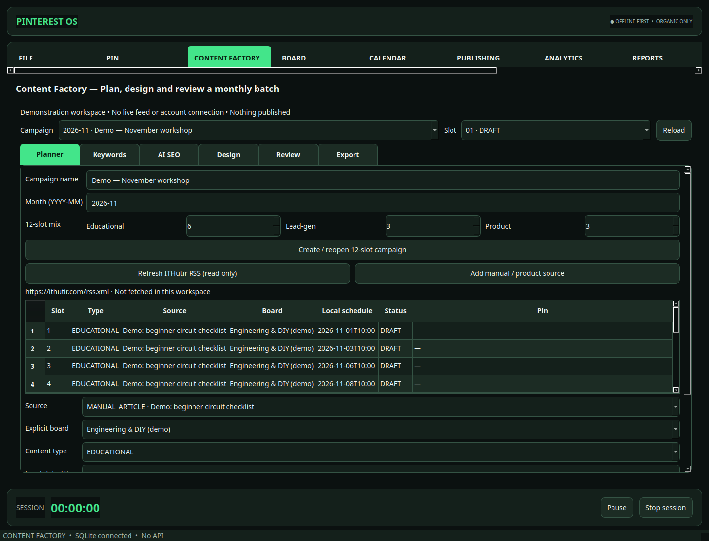

# Content Factory — Phase 1

Implements [GitHub issue #1](https://github.com/merxdc12/Dyrektor_Sale/issues/1) locally. No Pinterest account login, API posting, browser automation, paid advertising, deployment or website changes are involved.

## Linux Mint setup

From the repository root, with Python 3.11 or later and a desktop session:

```bash
python3 -m venv .venv
source .venv/bin/activate
python -m pip install -r requirements.txt
python -m pip install pytest
python -m pinterest_os
```

On a Mint installation missing Qt's XCB runtime libraries, install the distribution packages `libxcb-cursor0`, `libxkbcommon-x11-0` and `libxcb-xinerama0` before launching. Tests can run without an X server:

```bash
QT_QPA_PLATFORM=offscreen python -m pytest -q
QT_QPA_PLATFORM=offscreen python -m pytest -q tests/test_content_factory.py tests/test_content_feed.py tests/test_content_factory_ui.py
```

## Prepare a monthly batch

1. In BOARD, create boards with their destination URLs. In FILE, add any associated POD, KDP or free-tool products.
2. Open **CONTENT FACTORY → Planner**. Enter a campaign name and `YYYY-MM`; choose an educational / lead-gen / product mix totaling twelve. The default is 6 / 3 / 3. Repeating the same name and month reopens the existing twelve slots without overwriting edits. Dates are spread across that month at 10:00 local time; they are suggestions, not claims about optimal posting times.
3. Click **Refresh ITHutir RSS (read only)** or **Add manual / product source**. Manual types are MANUAL_ARTICLE, POD, KDP, FREE_TOOL and AFFILIATE. RSS entries retain feed provenance, GUID, canonical URL, publication text, summary, image URL metadata and last-seen time. Missing image metadata is visible and does not prevent planning.
4. Select a slot, its source, an explicit board and its local date/time, then **Save selected slot**. Source topic, product and suggested board can be edited separately. A suggested board never silently assigns a slot. Repeat for all twelve slots.
5. In **Keywords**, record phrases with origin and observation date. Unknown volume and competition stay blank, including for AI suggestions. Numeric metrics require VERIFIED status, a public evidence URL and a scale/period definition. VERIFIED means the editor supplied supporting evidence; the application does not independently verify the provider. There is no generated keyword volume or competition score.
6. In **AI SEO**, enter title and description manually, or copy the optional prompt to your chosen AI tool and paste its JSON response. Expected fields: `title`, `description`, optional `alt_text`, `disclosure`. Limits are 100 characters for title and 500 each for description and alt text. Every revision remains DRAFT. AI imports cannot attest to image review. This mode does not call an AI API or store credentials.
7. In **Design**, open the slot in the existing **PIN → Pin Designer**. This creates one linked DRAFT pin, once. Use existing templates, editing and export to create a real **1000 × 1500 PNG**. The factory does not download RSS images, copy source HTML into a design, or assume rights to source imagery.
8. Return to **AI SEO**, preview the exported image, write accurate alt text, tick the image-review attestation, and save the draft. The attestation is bound to the PNG's bytes. A changed image needs a new preview and attestation. An affiliate disclosure must appear in the description as well as the disclosure field.
9. In **Review**, run the checks, inspect the image, verify the destination and board yourself, then enter reviewer initials/name and a note and click **Approve selected slot**. URL checks validate syntax and public HTTP(S) schemes; they do not confirm that the destination is reachable or factually correct. The checklist verifies the source, board mapping, copy, affiliate disclosure, PNG decoding/dimensions, image-review attestation and duplicate candidates.
10. In **Export**, export one approved slot or all approved slots. Each slot's handoff is atomic and independently retryable. Successful slots are retained if another slot fails; the notice identifies failures. Existing PIN records become READY and existing Calendar records are created. An unapproved or stale slot is refused. Use the existing Calendar to reschedule and Publishing to publish manually. Publishing's copy action includes reviewed alt text for factory pins.

An exported slot is locked against accidental factory edits. To revise an unpublished creative, use **Review → Return unpublished export to review**. This returns the pin to DRAFT and cancels pending Calendar entries while retaining their history. Review and export again. Published content cannot be withdrawn this way. If someone changes exported PIN metadata or the saved image, manual publication confirmation refuses stale factory approval.



## Duplicates and publication evidence

- Source deduplication uses both feed-scoped GUID aliases and normalized canonical URLs. Tracking query parameters and fragments are removed; meaningful query parameters are preserved. A changed URL with the same GUID, or changed GUID with the same URL, retains one source. Conflicting aliases across existing sources are reported and skipped rather than merging records with campaign history.
- Creative duplicates compare the PNG's SHA-256 and canonical destination across the existing PIN library, including legacy pins, and the exported creative ledger. The ledger retains approved image hashes and publication evidence even if the local pin is later deleted. Another title or board does not make the same image and destination a new creative. Distinct PNGs for the same article are allowed. This is exact-byte detection, not perceptual image similarity.
- `RSS_ELIGIBLE` means the article was observed in the configured feed. It is a local candidate state, not a claim that Pinterest accepted the article or image. Feed absence on a later bounded refresh does not prove removal; last-seen timestamps remain available.
- `PINTEREST_CONNECTION_UNKNOWN` remains unknown after successful fetch, design, approval, export and manual publishing confirmation. This MVP does not connect or verify an account's RSS configuration.
- `PUBLISHED_CONFIRMED` in the ledger requires an editor to supply a published Pinterest pin URL with a numeric pin ID. It records human-provided evidence, not API verification. A source-level row describes article evidence; per-pin rows describe specific exported creatives. A feed refresh never changes publication evidence or implies all creatives were published.
- Existing Publishing's local PUBLISHED flag remains distinct from remote evidence in this ledger. Confirming manual publication does not populate a remote URL or establish RSS connection.

## Analytics and exports

Campaign slots retain links to existing pin IDs. The Export tab summarizes existing pin-linked clicks, conversions, revenue, cost and tracked time. Missing observations display as unknown. Currencies remain separate. Revenue is not profit: reported business cost and separately entered ledger cost may overlap, and neither establishes complete business costs. Use the existing Analytics and Reports reconciliation tools. Campaign membership is a local grouping, not proof that Pinterest caused a sale.

The existing PIN CSV and Sheets exchange, Calendar, Publishing, Analytics and TIME continue to use their current schemas and pin IDs. Factory provenance, alt text, revisions and approvals stay in the local database; the existing CSV/Sheets formats are unchanged. Full workspace/project backups preserve this additional evidence. External asset portability uses the existing project backup system.

## Migration and recovery

`content_migrations.py` introduces version 1 in `content_schema_migrations`. All factory tables are additive; existing IDs and rows remain intact. Startup schema creation, older additive column upgrades and factory migration execute in one explicit transaction. Individual migration work uses a savepoint; it never implicitly commits unrelated work with `executescript`. Failure rolls back all startup changes and closes the connection. Foreign keys, checks, unique slot/source/ledger indexes and explicit review fingerprints enforce the workflow.

Before changing an existing database that lacks this migration, Storage creates a verified SQLite snapshot next to it, named `<database>.pre-content-factory.sqlite3`. An existing snapshot is never overwritten; a suffix is used on a subsequent failed/retried migration. Fresh databases do not need this snapshot, and migrated databases do not create another on each open. The snapshot is database-only; use FILE's full project backup for external image assets.

To inspect a pre-migration snapshot without changing it, copy it into a new folder and open the copy. To restore the previous database, close the application, preserve the current workspace, and copy the snapshot into a separate workspace path. Opening the copy in this version safely migrates it again. Do not overwrite an open SQLite database. Tests exercise both snapshot restoration and migration failure/retry.

## RSS limits and availability

Only `https://ithutir.com/rss.xml` is requested, using GET, normal TLS verification and a 10-second socket timeout. Redirects are refused, reads are limited to 2 MiB and checked against a 30-second elapsed budget between socket reads, and at most 200 items are parsed. Fetching runs in a worker; SQLite writes stay on the GUI thread. Responses for an old workspace are ignored after a project switch. Closing waits for the bounded refresh to finish rather than destroying an active worker.

XML DTDs/entities and UTF-16/32 payloads are refused. Text is stripped of HTML, script and style content. URL schemes, credentials and local/private addresses are rejected. Images are recognized from Media RSS content/thumbnail, image enclosures and HTML images in descriptions or encoded content; only their safe absolute URLs are retained. No image URLs, local paths, credentials or arbitrary endpoints from the feed are fetched.

Refresh errors preserve saved sources and last successful refresh time. A missing image is source metadata to resolve in Designer, not a reason to fabricate alt text. The live feed could not be verified in the implementation environment; see the test report. A successful local refresh establishes website feed availability only.
